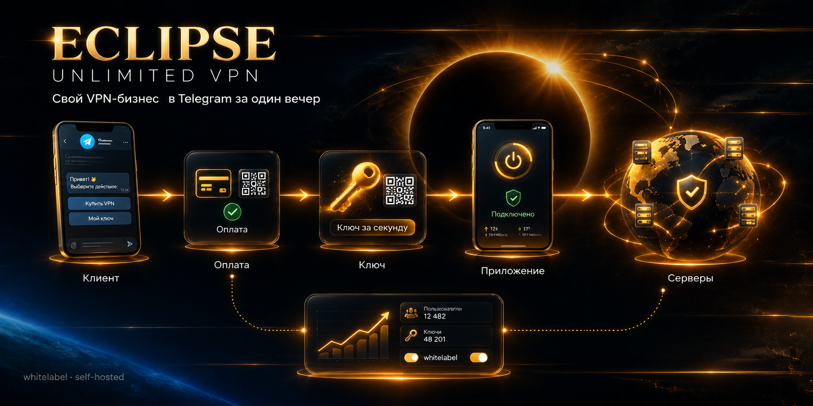
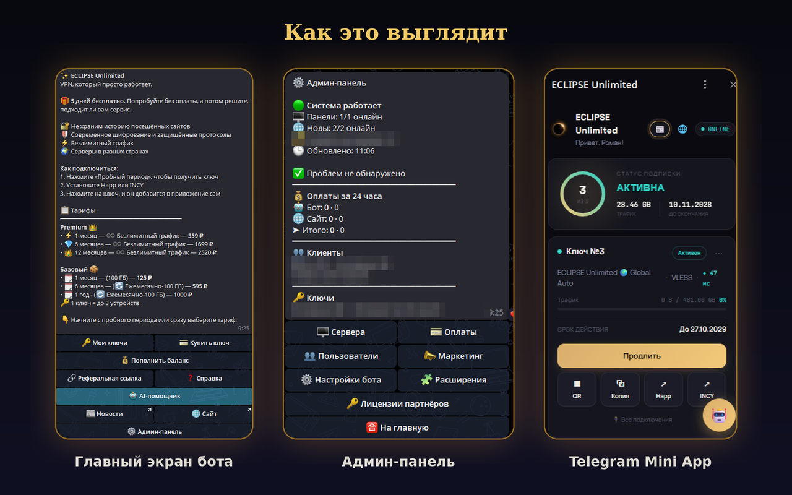

# ECLIPSE Unlimited VPN

<p align="center"></p>


**Готовый Telegram-бот для запуска собственного VPN-бизнеса на базе 3x-UI.** Приём оплаты, автоматическая выдача подписок (VLESS/Reality, XHTTP, Hysteria2), личный кабинет на сайте (Google/Яндекс/VK), AI-консультант с базой знаний, реферальная программа — всё из коробки.

**Быстрые ссылки:** [Установка](#-быстрая-установка-новый-чистый-сервер-ubuntu-24) · [Руководство администратора](ADMIN_GUIDE.md) · [Лицензия и платные функции](LICENSING.md) · [Переезд на другой сервер](MIGRATION.md) · [История версий](CHANGELOG.md) · [Безопасность](SECURITY.md)

## 🧭 Для кого это

- **Начинающий VPN-предприниматель** — ставите бота одной командой на чистый сервер Ubuntu, подключаете 3x-ui и оплату, продаёте подписки.
- **Владелец своего VPN-сервиса** — переносите клиентов, подключаете несколько серверов, сайт-витрину, Android-приложение со своим брендом.
- **Партнёр (whitelabel)** — свой бренд и свои клиенты на базе ECLIPSE; базовые функции бесплатны, дополнительные включаются лицензией.

## 🚦 Быстрый старт за 3 шага

1. Создайте бота у [@BotFather](https://t.me/BotFather) и узнайте свой Telegram ID.
2. На чистом сервере Ubuntu 24 выполните установку (команда в разделе «Быстрая установка» ниже).
3. Откройте бота, зайдите в админ-панель, добавьте сервер 3x-ui, тариф и способ оплаты — можно продавать.

## 📸 Как это выглядит

<p align="center"></p>

## ✅ Работает бесплатно, без лицензии

Продажа ключей и обслуживание клиентов работают без лицензии. Бесплатный лимит установки: до 2 активных серверов и до 100 активных ключей. По умолчанию превышение лимита только вызывает предупреждение админам раз в сутки (режим `warn`), ничего не блокируется. В режиме `enforce` блокируется лишь добавление серверов сверх лимита, ключи клиентов не блокируются никогда. Режим переключается командой `/license_limits`. Любая лицензия снимает лимиты полностью.

- 🤖 **Telegram-бот на aiogram 3** — подписки, тарифы, группы тарифов с собственными лимитами устройств и автосбросом трафика
- 💳 **Приём платежей** — ЮKassa, Telegram Stars и другие провайдеры через расширяемую систему
- ⚡ **Покупка в пару нажатий** — сервер для нового ключа выбирается автоматически (наименее загруженный), ключ, QR-код и ссылка показываются сразу после оплаты
- 🧹 **Чистый чат** — главное меню всегда одно, старые экраны убираются сами
- 💰 **Выгода длинных тарифов** — на кнопках тарифов от 2 месяцев показана цена за месяц
- 🔌 **Отображение подключений** — VLESS Reality/XHTTP и Hysteria2 с реальным пингом из браузера клиента
- ℹ️ **Описания протоколов** — по нажатию клиент видит, что это и в какой сети он лучше; готовность к MASQUE
- 🚧 **Узел в ремонте (блокировка IP)** — если IP сервера или ноды заблокирован, админ одной кнопкой убирает ноду мастер-панели из подписок клиентов или переключает сервер на резервный; ссылка подписки у клиента не меняется, тревоги по такому узлу не приходят, после замены IP узел возвращается нажатием
- 📡 **Статус серверов** — публичная страница `/status` и экран в «Справке», без раскрытия адресов
- 📊 **Админ-панель** — пользователи, серверы, тарифы, статистика
- 🩺 **Диагностика системы** — версия, база данных, диск, бэкапы, фоновые задачи, лицензия, каждая панель 3x-ui, Telegram API, ключи и оплаты на одном экране
- 🔔 **Оповещения о сбоях** — если панель, узел, диск, бэкап или планировщик «упали» на ~10 минут, бот пишет администратору в Telegram и сообщает о восстановлении. Без спама
- 🔄 **Безопасные автообновления** — новый код проверяется на реальный запуск, при сбое автоматический откат на предыдущую версию
- 🌍 **Мультиязычность** — язык выбирается при первом запуске и переключается в любой момент; переводятся бот, WebApp и публичный магазин
- 🔒 **Обязательная подписка на канал** — опционально: доступ к боту только для подписчиков канала (начатая оплата никогда не блокируется)
- 🧩 **Система кастомных расширений** — безопасное добавление своей логики без изменения ядра
- 🏷 **Брендинг** — своё название и логотип

---

## 🔑 Функции по лицензии

Любая лицензия открывает все функции этого раздела, тарифы отличаются только сроком действия. Без лицензии эти функции закрыты, но бот продолжает продавать и обслуживать клиентов. Правила, сроки и продление — в [LICENSING.md](LICENSING.md).

**Клиентам и продажам**
- 🎁 **Пробный период (автовыдача)** — с защитой от ботов (Cloudflare Turnstile + rate-limit) и настройкой на каждую группу тарифов
- 🎟 **Промокоды и купоны**
- 🔗 **Реферальная система** — с таблицей лидеров и настраиваемыми бонусами
- 🎁 **Бонусные дни за отзыв и сторис** — клиент присылает скриншот, админ одобряет одной кнопкой, каждое задание один раз
- 🎰 **Рулетка** — розыгрыш призов для клиентов
- 🤝 **Совместные акции с партнёрами** — ссылка с промокодом партнёра, цена со скидкой, аналитика

**Сайт и приложение**
- 🌐 **Сайт и личный кабинет** — вход через Google/Яндекс/VK и по телефону, покупка без установки Telegram
- 📞 **Верификация по звонку (Zvonok)** — защита от повторного пробного периода
- 🌐 **Автонастройка резервного домена** — DNS, nginx и SSL одним нажатием, на случай блокировки основного
- 📱 **Своё Android-приложение** — со своим брендом

**AI**
- 🤖 **AI-помощник** — консультант с базой знаний и реальными действиями: включает автопродление, сбрасывает список устройств, проверяет и завершает зависшие платежи
- 🌐 **AI-помощник на сайте** — чат на страницах /welcome и /shop: гостю подбирает тариф, клиенту помогает с подпиской, устройствами и продлением

**Подключения и маршрутизация**
- 🗺 **Маршрутизация Happ/INCY** — клиент выбирает вариант на карточке ключа: «🧠 Умный» (российские ресурсы напрямую, остальное через VPN), «🏦 БС» (whitelist: напрямую только банки, госсервисы и операторы) или «🔄 Как у всех». Админ видит, сколько устройств получили текущую версию профиля, и может отключить выбор клиентом
- 📲 **Импорт в Happ/INCY/Karing** — кнопки быстрого импорта подписки
- 🛡 **AmneziaWG, WireGuard и TUIC v5 в списке подключений** — с файлом `.conf`, QR-кодом и копированием ссылки; в боте кнопка «🛡 AmneziaWG» с пошаговой инструкцией
- 🧪 **Проверка подключений и оповещения о них** — порт, TLS, срок сертификата и (если установлен Xray) реальный трафик
- 🛰 **Проверка блокировок IP** — кнопка в карточке сервера и плановая проверка раз в 2 часа: сканеры в российских сетях показывают, блокирует ли ТСПУ адрес панели или ноды; при блокировке бот присылает тревогу (данные сервиса cheburcheck.ru)

**Администрирование и бренд**
- 📢 **Рассылка**
- 📰 **Публикация в канал/группу** — планирование постов с датой, временем и превью, поддержка фото, видео и GIF
- 🏷 **Отключение метки «Powered by ECLIPSE»** — входит в любую лицензию

---

## 🆘 Платная услуга (не лицензия)

- **Помощь для админа** — консультации, диагностика, настройка и доработки от создателя проекта прямо из бота. Заказ оформляется в боте, оплата через СБП; кнопка появляется, когда услуга включена

---

## 🔑 Whitelabel-лицензия

**Лицензия на код:** [Elastic License 2.0](LICENSE) с дополнительным разрешением для владельцев VPN-сервисов (см. [LICENSING.md](LICENSING.md)). Обход проверки лицензионных ключей запрещён.

Базовые функции (продажа ключей, тарифы, серверы, оплата, брендинг) работают всегда бесплатно. Премиум-функции (полный список — в разделе «🔑 Функции по лицензии» выше) включаются лицензией: любая лицензия открывает все из них, тарифы отличаются только сроком.

**Коротко о правилах:** без лицензии бот продаёт и обслуживает клиентов в пределах бесплатного лимита (до 2 серверов и 100 активных ключей, подробности в разделе «✅ Работает бесплатно»), ключи оплативших клиентов не блокируются никогда; при недоступности лицензионного сервера платные функции работают ещё 72 часа; один ключ — две установки бота; ключ вводится кнопкой «💳 Моя лицензия» или в `secrets.env` (`LICENSE_KEY`). Полные правила, список закрытых функций и порядок продления — в [LICENSING.md](LICENSING.md).

👉 [Что именно даёт лицензия и зачем это вашему бизнесу](LICENSING.md)

---

## 🖥️ Требования к серверу

| | Минимум | Рекомендуется |
|---|---|---|
| CPU | 1 vCPU | 2 vCPU |
| RAM | 2 ГБ | 4 ГБ |
| Диск | 15 ГБ SSD | 25+ ГБ SSD |
| ОС | Ubuntu 24.04 | Ubuntu 24.04 |

Бот сам по себе лёгкий (~150 МБ памяти), но AI-консультант (опционален, работает через внешний Groq API) в пиках использует до ~1 ГБ — на серверах с 2 ГБ RAM рекомендуется настроить своп (2 ГБ), чтобы не рисковать нехваткой памяти в моменты нагрузки. Без AI-консультанта достаточно и 1 ГБ RAM.

Подойдёт практически любой бюджетный VPS (Timeweb, Selectel, Reg.ru, Hetzner и подобные).

---

## 🚀 Быстрая установка (новый чистый сервер Ubuntu 24)

Подключитесь к серверу по SSH и выполните одну команду:

```bash
bash <(curl -sL https://raw.githubusercontent.com/pomah7878-bot/ECLIPSE_VPN/main/install.sh)
```

Выберите **1) 🚀 Установка**, введите токен бота (от @BotFather) и ваш Telegram ID — скрипт автоматически:
- обновит системные пакеты
- скачает репозиторий
- создаст виртуальное окружение и установит Python-зависимости
- настроит автозапуск через systemd (`eclipse-vpn.service`)
- запустит бота

### Автоматический запуск без диалогов

```bash
bash <(curl -sL https://raw.githubusercontent.com/pomah7878-bot/ECLIPSE_VPN/main/install.sh) install <BOT_TOKEN> <ADMIN_ID>
```

### Обновление уже установленного бота

```bash
cd /root/EclipseVPN
bash install.sh update
```

---

## 📋 Что нужно подготовить заранее

| Что | Где получить |
|---|---|
| Токен Telegram-бота | [@BotFather](https://t.me/BotFather) → `/newbot` |
| Ваш Telegram ID (для админ-доступа) | [@userinfobot](https://t.me/userinfobot) |
| VPN-сервер с панелью 3x-ui | Любой VPS + [установка 3x-ui](https://github.com/MHSanaei/3x-ui) |
| Домен + SSL (для WebApp/сайта) | Любой регистратор + Let's Encrypt / Certbot |

---

## 🔑 Ручная настройка секретов (после установки)

Установщик создаст `config.py` из ваших ответов, но часть настроек нужно дополнить вручную.

### 1. `secrets.env` — в корне проекта

```bash
cp secrets.env.example secrets.env
nano secrets.env
```

Обязательные для полного функционала:
```env
GROQ_API_KEY=              # console.groq.com — для AI-консультанта
SUPPORT_API_TOKEN=         # любая случайная строка — внутренний токен между ботом и AI-сервисом
```

Для оплаты через ЮKassa (настраивается через админ-панель бота):
- Shop ID и Secret Key — [yookassa.ru](https://yookassa.ru) → личный кабинет → Настройки → API

### 2. OAuth-вход в личный кабинет (Google / Яндекс / VK) — по желанию

Добавьте в `secrets.env`, если нужен вход через соцсети на сайте:
```env
GOOGLE_OAUTH_CLIENT_ID=
GOOGLE_OAUTH_CLIENT_SECRET=
YANDEX_OAUTH_CLIENT_ID=
YANDEX_OAUTH_CLIENT_SECRET=
```

Redirect URI при регистрации приложений — **обязательно с вашим доменом**:
```
https://ваш-домен/auth/google/callback
https://ваш-домен/auth/yandex/callback
```

### 3. Nginx + SSL для WebApp и сайта

Порядок важен: сначала HTTP-конфиг без сертификатов, затем certbot сам добавит HTTPS. Если сразу написать `listen 443 ssl` с несуществующими сертификатами, nginx не запустится.

**1. Направьте домен на сервер.** В DNS создайте A-запись `ваш-домен` → IP сервера и подождите несколько минут. Проверка: `dig +short ваш-домен` должен вернуть IP сервера.

**2. Создайте конфиг** `/etc/nginx/sites-available/eclipse` (адаптируйте под свой домен):
```nginx
server {
    listen 80;
    server_name ваш-домен;
    location / {
        proxy_pass http://127.0.0.1:3000;
        proxy_http_version 1.1;
        proxy_set_header Host $host;
        proxy_set_header X-Real-IP $remote_addr;
        proxy_set_header X-Forwarded-For $proxy_add_x_forwarded_for;
        proxy_set_header X-Forwarded-Proto $scheme;
    }
}
```

**3. Включите конфиг и получите SSL-сертификат:**
```bash
apt install nginx certbot python3-certbot-nginx -y
ln -s /etc/nginx/sites-available/eclipse /etc/nginx/sites-enabled/eclipse
nginx -t && systemctl reload nginx
certbot --nginx -d ваш-домен
```
Certbot сам допишет в конфиг блок `listen 443 ssl` и пути к сертификатам, а также редирект с HTTP на HTTPS.

**4. Укажите домен в боте:** «🌐 Сайт и витрина» → «🌐 Домен сайта» (`https://ваш-домен`).

**5. Проверьте:** `curl -I https://ваш-домен` должен ответить `200`, а в браузере открыться сайт. Если ответ `502`, бот не запущен: `systemctl status eclipse-vpn`.

### 🧪 Проверка подключений: настройка

1. Откройте «🩺 Диагностика» → «🧪 Проверка подключений» → «🔑 Выбрать ключ» и выберите **свой** ключ. Лучше взять ключ без жёсткого лимита устройств: бот проверяет с одного IP.
2. Нажмите «▶️ Проверить сейчас». Без Xray проверяются порт, TLS и срок сертификата.
3. Для реального теста (идёт ли трафик через подключение) установите Xray на сервер бота:
```bash
apt install -y unzip
mkdir -p /opt/eclipse-probe && cd /opt/eclipse-probe
curl -L -o xray.zip https://github.com/XTLS/Xray-core/releases/latest/download/Xray-linux-64.zip
unzip -o xray.zip xray && chmod +x xray && rm xray.zip
./xray version
```
4. Автопроверка раз в 15 минут включена по умолчанию: если подключение не работает дольше ~30 минут, бот напишет администратору.

Важно: проверка идёт с сервера бота, а не из сети клиента. Она покажет, что подключение живо, но не покажет блокировку у конкретного оператора. Реальным тестом проверяются VLESS, Trojan, VMess, Shadowsocks и Hysteria2 (кроме Hysteria2 с обфускацией и с самоподписанным сертификатом без `pinSHA256`). TUIC, WireGuard и AmneziaWG не проверяются, они показываются одной строкой «Не проверяются».

---

## 🛠️ Управление ботом

```bash
systemctl status eclipse-vpn    # статус
systemctl restart eclipse-vpn   # перезапуск
systemctl stop eclipse-vpn      # остановка
journalctl -u eclipse-vpn -f    # логи в реальном времени
```

---

## 🗄️ Ежедневный бэкап базы данных

В репозитории уже есть готовый скрипт `backup_db.sh`:

```bash
chmod +x /root/EclipseVPN/backup_db.sh
crontab -e
```

Добавьте строку:
```
0 4 * * * /root/EclipseVPN/backup_db.sh >> /root/backups/backup.log 2>&1
```

---

## ⚠️ Важно

- `config.py` и `secrets.env` никогда не попадают в git (см. `.gitignore`) — храните их только на сервере
- База данных (`database/vpn_bot.db`) создаётся автоматически при первом запуске
- Перед подключением реальной VPN-панели убедитесь, что 3x-ui доступен и API-профиль (`clients_api` или `xui_api`) настроен корректно


## 💝 Поддержать проект

Если этот проект оказался полезен и вы хотите поддержать его дальнейшую разработку — можно оставить пожертвование любой суммы, какую посчитаете нужной:

**[💳 Поддержать проект через ЮKassa](https://yookassa.ru/my/i/amQkWbtLCsPO/l)**

Спасибо, что пользуетесь ECLIPSE Unlimited! 🙏

---

## 🚚 Переезд на другой сервер

Пошаговая инструкция с готовыми скриптами экспорта и импорта (база, токен, секреты, логотип, nginx): **[MIGRATION.md](MIGRATION.md)**.

---

## История версий

Полный список изменений — в [CHANGELOG.md](CHANGELOG.md). Последние версии:

- **1.411–1.417** — блокировки и надёжность: «🚧 Узел в ремонте» (нода мастер-панели убирается из подписок и возвращается кнопкой в карточке сервера, резервный сервер на время блокировки, такие узлы не считаются аварией и не проверяются), TUIC возвращается в подписку, если панель 3x-ui отдаёт её с пустыми строками, автонастройка резервного домена работает и без Cloudflare (ручная A-запись)
- **1.385–1.392** — маршрутизация Happ/INCY: профили «Умный» и «БС», выбор варианта клиентом на карточке ключа, переключатель и статистика получения профиля в админке; у обоих вариантов одно название профиля, новый заменяет прежний; функция входит в лицензию («🗺 Маршрутизация»)
- **1.335–1.350** — новая главная админ-панели со сводкой и блоком «Требует внимания»; главная клиента «как приложение» (разный экран новичку, клиенту и истёкшей подписке, кнопка «⚡ Подключиться»); «Вид главной» в настройках — можно вернуть классический вид; цены на экране покупки; навигация «Назад» и «На главную» на всех экранах; единый вид сумм и правильное склонение дней в уведомлениях; проверка платежей: ЮKassa, WATA, Platega, Cardlink, Stars, карты, баланс и покупка на сайте
- **1.294–1.305** — покупка без лишних шагов: сервер для нового ключа выбирается автоматически, ключ, QR и ссылка показываются сразу после оплаты в WebApp; порядок в чате — одно главное меню, без хвоста старых сообщений; бонусные дни за отзыв и сторис с проверкой админом и уведомлениями (платная функция); статус серверов — страница /status и экран в «Справке», без адресов серверов; описания протоколов в WebApp и боте; цена за месяц на кнопках длинных тарифов; подготовка к MASQUE (бот не трогает такие подключения, пока поддержка не включена); отчёт бота партнёра о реально работающих функциях лицензии; расширенная диагностика «🩺 Диагностика»: база, диск, бэкапы, планировщик, лицензия, панели 3x-ui, Telegram, ключи и оплаты на одном экране
- **1.195–1.201** — платежи и подключения: оплата и выдача ключа защищены от потерь при сбое (резерв баланса, повторная выдача оплаченного заказа, учёт платежей Telegram); возврат средств только на баланс; в подписке отображаются все протоколы панели 3x-ui — AmneziaWG, WireGuard, TUIC v5, Hysteria2, VLESS — в WebApp и на сайте (скачивание конфига, копирование ссылки, QR без внешних сервисов), функция входит в лицензию; в боте на экране «Показать подписку» появилась кнопка «🛡 AmneziaWG» с инструкцией, файлом `.conf` и QR; «Назад» и «На главную» на этих экранах — в одну строку, файл с личным ключом и QR удаляются из чата при возврате
- **1.165–1.168** — лицензия партнёров: ключ по оплате выдаётся один раз и только покупателю, автовыдача при оплате без нажатия «Я оплатил», проверка кода до сохранения, подписанные ответы лицензионного сервера, привязка ключа к двум установкам и сброс в карточке партнёра, напоминания об окончании за 7 и 1 день, рефералка и промокоды закрыты лицензией полностью, правила и условия в `LICENSING.md`
- **1.154** — инструкция по переезду бота на другой сервер (`MIGRATION.md`) и скрипты `scripts/migrate_export.sh` / `scripts/migrate_import.sh`; исправлена переустановка через `install.sh`: раньше она не сохраняла базу данных, `secrets.env`, логотип и расширения, теперь сохраняет
- **1.60–1.80** — резервный домен сайта на случай блокировки: автонастройка одним нажатием (DNS через Cloudflare API либо ручная A-запись + nginx + SSL полностью автоматически), мгновенное переключение основной/резервный, удаление обеих настроек (в т.ч. прямо с экрана редактирования), платная функция whitelabel-лицензии; безопасность — сессии личного кабинета сайта больше не подписываются чужим секретом (использовался токен отдельного AI-support сервиса); смена IP/домена панели теперь сразу проверяется на доступность перед сохранением; подписка Happ/INCY переживает временную недоступность панели — при сбое отдаётся последняя рабочая подписка из кэша вместо ошибки (найдено по реальному инциденту с сутками таймаутов на одном из партнёрских серверов); AI-суппорт — раздел ключей переименован из «Внешние ключи и API», добавлен переключатель вкл/выкл (кнопка на главном экране теперь корректно скрывается при выключении), новый инструмент — AI может доставить клиента на экран продления ключа, не только замены; темы витрины /shop дополнены реальной сменой формы/теней/шрифта, не только цвета; появилась возможность удалить неиспользованный промокод/купон; пошаговые мастера ввода (создание промокода, генератор купонов) больше не копят все шаги в чате; убраны кнопки быстрого импорта, дублировавшиеся на карточке ключа; ежедневная статистика и бэкап теперь с кнопкой «На главную»; несколько находок нелогичной навигации, в том числе переключатели в разделе «Сайт и витрина», которые вылетали в родительское меню вместо того, чтобы остаться на месте
